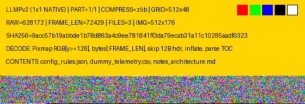

# datapixels

**Text → RGB → Pixel → LLM** — *Turn folders, notes, and spreadsheets into portable picture cartridges for mobile AI chats.*

[](https://ubuv6vvyv.github.io/datapixels/packer.html)
[](https://ubuv6vvyv.github.io/datapixels/viewer_dln1.html)
[](LICENSE)



## What Is This?

Mobile AI apps (Gemini, Meta AI on WhatsApp, ChatGPT) have two frustrating limits when you work from a phone:
1. **You can't feed them big datasets:** Pasting a 10 MB spreadsheet or hundreds of project files into chat gets cut off immediately.
2. **You can't easily get big results back:** Messaging apps like WhatsApp compress photos into blurry JPEGs and restrict file exports from chat bots.

**datapixels** turns ordinary pictures and single-page PDFs into a two-way storage drive for AI chats—with no servers, databases, or API keys:

* **Send Data In ([`packer.html`](https://ubuv6vvyv.github.io/datapixels/packer.html) / [`packpng.py`](packpng.py)):** Compresses your files or pasted text into colored pixels beneath a yellow summary banner. Upload the resulting PDF to an AI chat, paste the generated decoder snippet, and your entire folder is mounted in the AI's memory ready to search and analyze.
* **Get Data Back ([`viewer_dln1.html`](https://ubuv6vvyv.github.io/datapixels/viewer_dln1.html)):** When the AI finishes analyzing your data, it packs the output into high-contrast black-and-white tile images that survive WhatsApp photo compression intact. Open those images in the browser viewer to rebuild and download your file.

---

## Try It Live in Your Browser (Zero Setup)

Both web tools run 100% locally inside your phone or desktop browser—your files never touch an external server.

| Live Web App | What It Does |
| :--- | :--- |
| **[`packer.html` — Browser Cartridge Packer](https://ubuv6vvyv.github.io/datapixels/packer.html)** | Select local files or paste raw text to render a downloadable `LLMPv2` PNG/PDF cartridge and generate the copy-paste AI decoder snippet. |
| **[`viewer_dln1.html` — Browser Archive Reconstructor](https://ubuv6vvyv.github.io/datapixels/viewer_dln1.html)** | Select one or more `DLN1` black-and-white images (including JPEGs sent through WhatsApp) to decode and download the reconstructed JSON or text file. |

### 10-Second Decoder Test
1. Open **[viewer_dln1.html](https://ubuv6vvyv.github.io/datapixels/viewer_dln1.html)** in your browser.
2. Download the pre-made WhatsApp-compressed test image from this repo: **[examples/sample_dln1_whatsapp_sim.jpg](examples/sample_dln1_whatsapp_sim.jpg)**.
3. Select `sample_dln1_whatsapp_sim.jpg` inside the viewer—it decodes the JPEG-degraded tiles and reconstructs the original JSON output in milliseconds.

> [!TIP]
> **Using Multiple Export Images?** If an AI splits a large export across several `DLN1` photos (e.g., `01` through `06`), select them inside `viewer_dln1.html` in exact order from first to last so they stitch together cleanly.

---

## Command-Line Quickstart (Termux / Linux / macOS)

For whole directories, recursive codebases, or multi-megabyte CSV files, use the Python CLI packer:

```bash
pip install -r requirements.txt
python3 packpng.py -d ./my_folder --recursive --clip
```

1. **Upload:** Attach the generated `llmp_<timestamp>.pdf` in your AI chat (send as a **Document** if using WhatsApp).
2. **Mount:** Paste the `LLM SANDBOX DECODER` code block from `llmp_<timestamp>_manifest.txt` into the chat.
3. **Query in RAM:**
   * `run()` — Deduplicates files, scores entries by information density, and profiles CSV columns.
   * `search_files("keyword")` — Finds matching lines across every file and chunk.
   * `query_csv("term", col="column_name")` — Filters rows across oversized, auto-chunked spreadsheets.
   * `get_block(1)` — Pages through logical ~500 KB working sets safely under chat output limits.

---

## Repository Map

| File / Folder | Purpose |
| :--- | :--- |
| [`packer.html`](packer.html) | Minimalist browser app to pack files or pasted text into `LLMPv2` PNG/PDF cartridges. |
| [`viewer_dln1.html`](viewer_dln1.html) | Mobile-optimized browser app to decode `DLN1` 1-bit JPEGs/PNGs and download rebuilt files. |
| [`packpng.py`](packpng.py) | Streaming Termux/desktop CLI packer with automatic CSV row-chunking and embedded `00_scan.py`. |
| [`generate_test_suite.py`](generate_test_suite.py) | Deterministic test generator that creates dummy files and verifies round-trip `SHA-256` integrity. |
| [`examples/`](examples/) | Pre-built `LLMPv2` PDF/PNG cartridges, a simulated WhatsApp `DLN1` JPEG, and [`verification_report.json`](examples/verification_report.json). |

---

## Technical Architecture & Protocol Specs

### Performance & Capacity Benchmarks

| Specification | Inbound (`LLMPv2` 1×1 RGB PDF) | Outbound (`DLN1` 8×8 1-Bit JPEG) |
| :--- | :--- | :--- |
| **Encoding Geometry** | `1×1` native RGB pixels (3 bytes/px) | `8×8` macro-tiles (`0` = black, `255` = white; 1 bit/tile) |
| **Max Capacity / Frame** | ~11.25 MiB compressed / ~45 MB raw (`2048×2048`) | ~32.7 KB deflated payload (`4096×4096`) |
| **Transport Channel** | WhatsApp Document / Direct File Upload | Standard WhatsApp Photo (survives lossy JPEG) |
| **Decoder Runtime** | Python sandbox (`fitz`, `numpy`, `json` only) | Browser `<canvas>` + `DecompressionStream` |
| **Mobile Decode Speed** | ~40 ms in C via `fitz.xref_stream` | < 150 ms across 6 frames on Android/iOS |

### How Inbound (`LLMPv2`) Works
* **Header & Frame Layout:** Rows `0..127` render a high-contrast `#FFD400` manifest banner with RGB calibration swatches, byte lengths, and a `SHA-256` checksum. Rows `128+` store raw bytes (`b"LLMP"` magic + version/flags/part metadata + `zlib`-compressed TOC and file blob) mapped directly onto RGB channels.
* **Sandbox Import Bypass:** Locked-down mobile AI Python sandboxes frequently block `import zlib`, `struct`, `re`, and `hashlib`. The generated decoder wraps the raw compressed bytes inside an in-memory 3-object PDF header and calls MuPDF's `fitz.xref_stream(3)` to inflate the archive in C using only `fitz`, `numpy`, and `json`.
* **Automatic CSV Row-Chunking:** Line-oriented files (`.csv`, `.tsv`, `.jsonl`, `.log`) larger than `--block-kb` (default `500 KB`) are sliced along newline boundaries in `64 KB` streaming RAM, with CSV/TSV column headers prepended to every slice so each `INDEX_XX` block is standalone.

### How Outbound (`DLN1`) Works
* **Compression Survival:** WhatsApp re-encodes outbound images at roughly JPEG quality 70 with `4:2:0` chroma subsampling. Encoding bits as `8×8` blocks of pure `0` and `255` creates a 255-step luminance gap that thresholds cleanly at `128` even after aggressive recompression.
* **Hardware Tile Sampling:** `viewer_dln1.html` verifies the alternating `0, 255, 0, 255...` sync pattern on Row 0, downscales the image via `imageSmoothingEnabled = false` so the GPU samples tile centers directly, and inflates raw deflate or zlib streams natively.

### Reproduce the Verification Suite

```bash
python3 generate_test_suite.py
```

Builds a ~580 KB dummy dataset in `test_corpus/`, packs it into `examples/sample_llmp_bundle.pdf` and `examples/sample_llmp_bundle.png`, encodes a `DLN1` export degraded with `quality=70, subsampling=2` (`examples/sample_dln1_whatsapp_sim.jpg`), and writes verified `SHA-256` results to [`examples/verification_report.json`](examples/verification_report.json).

---

## Security & Responsible Use

> [!CAUTION]
> **Treat Cartridges as Untrusted Input:** `LLMPv2` archives can contain arbitrary text payloads alongside embedded Python helper scripts (`00_scan.py`). Always inspect embedded code before running it in shared or sensitive environments. Use this tool only on data and systems you own or have explicit authorization to test.
